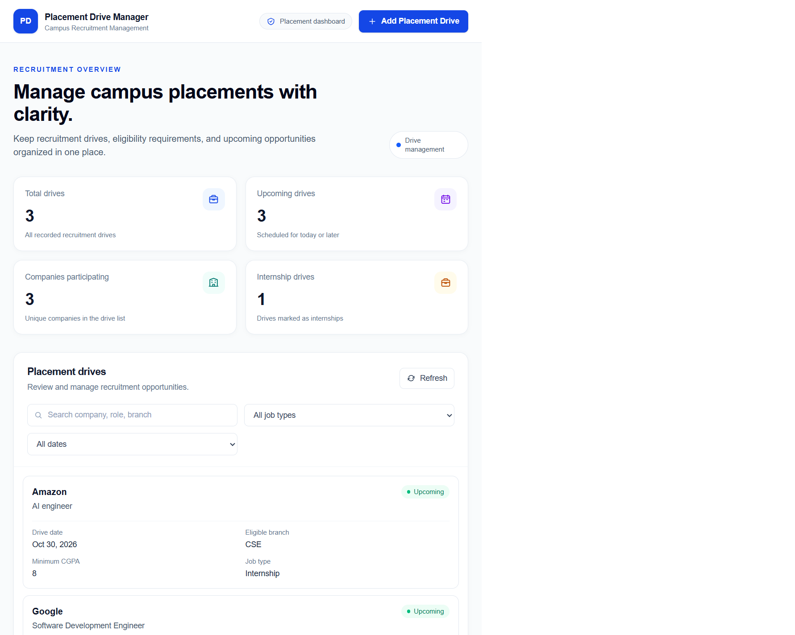
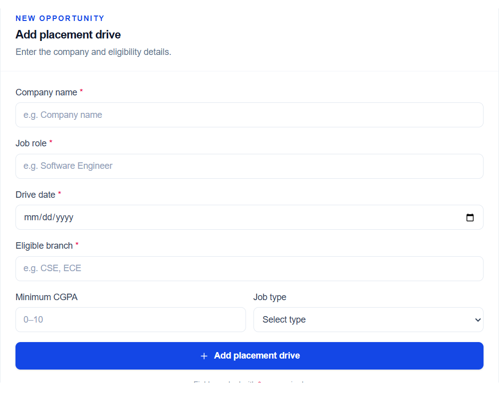
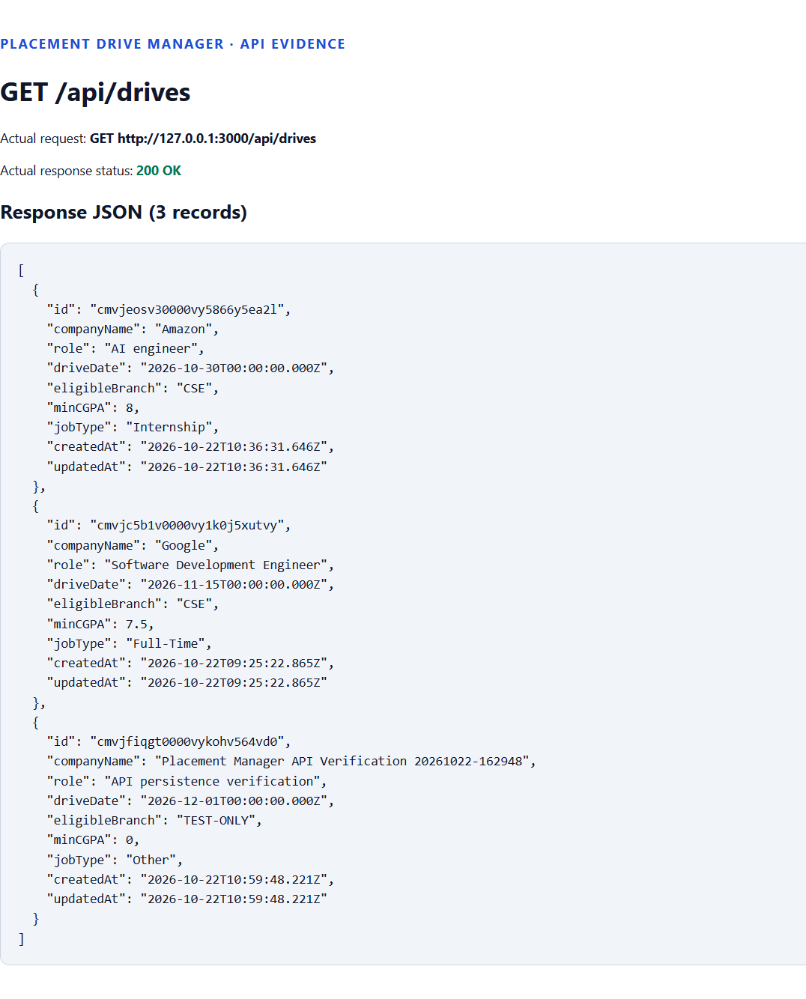
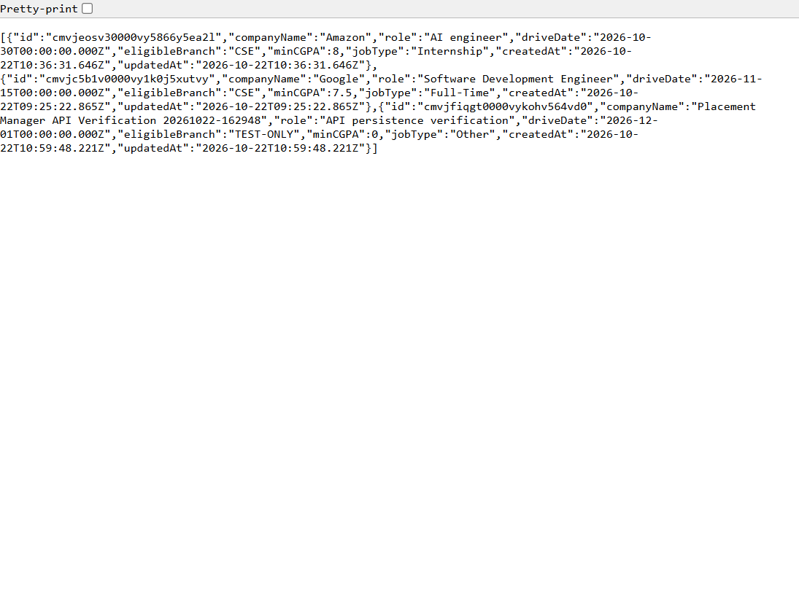
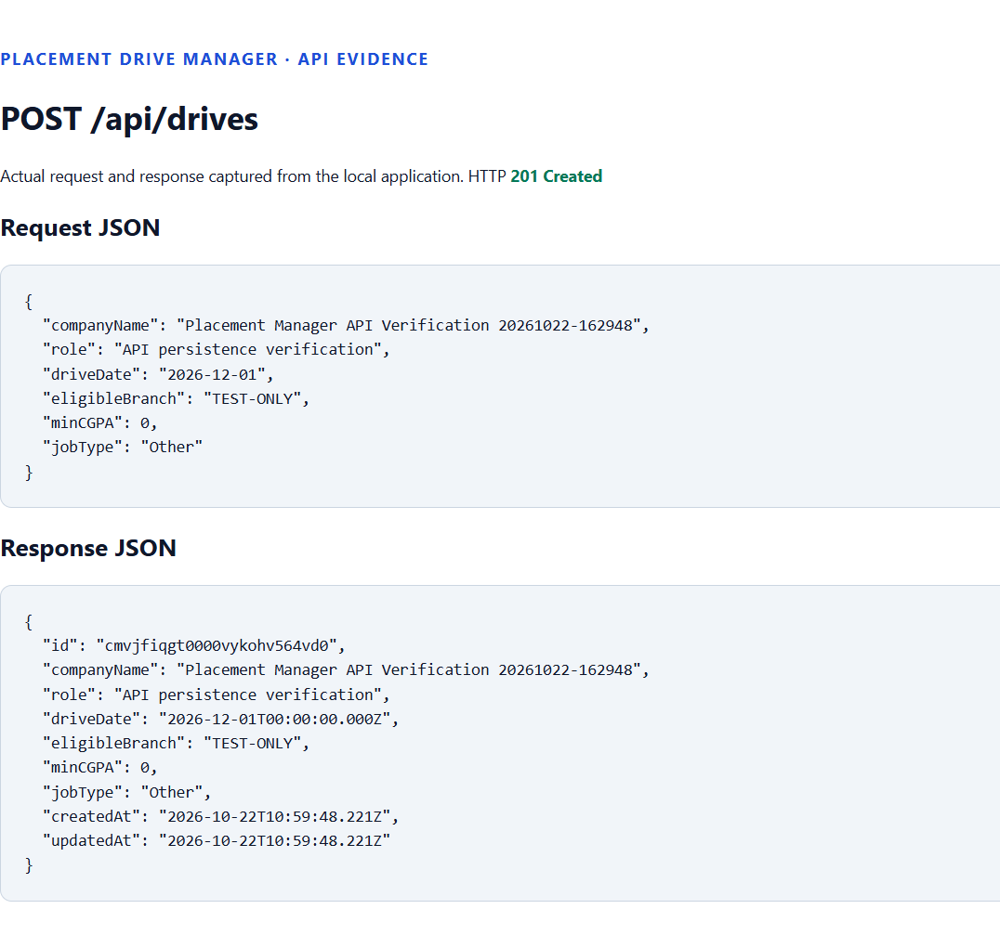
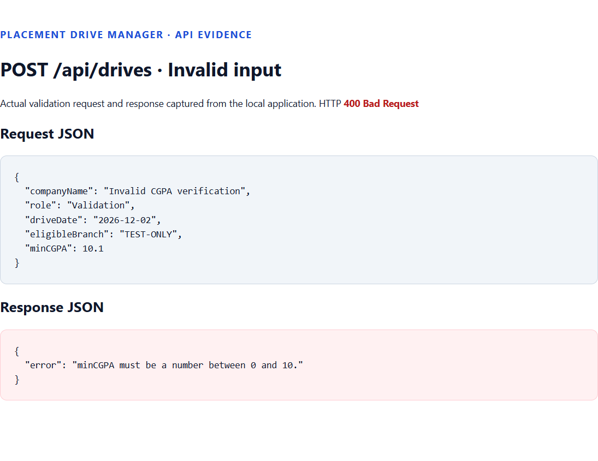

# 🎓 Placement Drive Manager

### A Full-Stack Campus Recruitment Management Application

Manage campus recruitment drives, organize eligibility requirements, and track placement opportunities through a responsive dashboard built with **Next.js, Tailwind CSS, PostgreSQL, and Prisma ORM**.

<p align="center">
  <a href="https://placement-drive-manager-xi.vercel.app/">
    
  </a>
  <a href="https://github.com/pragat1/placement-drive-manager">
    
  </a>
</p>

<p align="center">
  
  
  
  
  
  
</p>

---

## 📌 Table of Contents

- [Overview](#-overview)
- [Key Features](#-key-features)
- [Technology Stack](#-technology-stack)
- [Application Preview](#-application-preview)
- [Database Design](#-database-design)
- [Getting Started](#-getting-started)
- [Environment Configuration](#-environment-configuration)
- [Database Setup](#-database-setup)
- [Running the Application](#-running-the-application)
- [API Documentation](#-api-documentation)
- [Project Structure](#-project-structure)
- [Validation and Error Handling](#-validation-and-error-handling)
- [Deployment](#-deployment)
- [Future Enhancements](#-future-enhancements)
- [Author](#-author)

---

## 🌟 Overview

**Placement Drive Manager** is a full-stack web application designed to simplify the organization and tracking of campus recruitment drives.

The application provides a centralized dashboard where users can add placement opportunities, review recruitment details, search records, and filter drives according to their requirements.

It combines a responsive frontend with REST API endpoints and a PostgreSQL database to provide persistent data storage.

### 🎯 Project Objectives

- Simplify the management of campus placement drives.
- Maintain structured information about companies and job opportunities.
- Record eligibility requirements, including eligible branches and minimum CGPA.
- Provide a responsive interface for viewing recruitment records.
- Implement validated REST API endpoints for creating and retrieving records.
- Demonstrate database integration using Prisma ORM and PostgreSQL.

---

## ✨ Key Features

### 📊 Interactive Dashboard

- Overview of total placement drives.
- Count of upcoming recruitment drives.
- Number of unique participating companies.
- Count of internship opportunities.
- Clear presentation of recruitment information.

### ➕ Placement Drive Management

Create placement drive records with the following information:

| Field | Description | Requirement |
|---|---|---|
| Company Name | Name of the recruiting organization | Required |
| Job Role | Position being offered | Required |
| Drive Date | Scheduled recruitment date | Required |
| Eligible Branch | Eligible academic branches | Required |
| Minimum CGPA | Minimum academic eligibility threshold | Optional |
| Job Type | Internship, Full-Time, or Other | Optional |

### 🔎 Search and Filtering

- Search by company name.
- Search by job role.
- Search by eligible branch.
- Filter by job type.
- Filter by upcoming or past drives.
- Clear active filters to restore the complete list.

### 📱 Responsive Interface

- Desktop-friendly placement table.
- Mobile-friendly placement cards.
- Responsive layouts for different screen sizes.
- Consistent spacing, typography, and visual hierarchy.
- Interactive controls with visible focus indicators.

### ⚡ User Feedback and Error Handling

- Loading indicators while retrieving records.
- Informative empty states when no drives exist.
- Error messages when requests fail.
- Retry controls for failed data retrieval.
- Success feedback after creating a placement drive.
- Form reset after successful submission.
- Client-side validation for required fields and CGPA.

### 🗄️ Persistent Database Storage

- PostgreSQL for persistent data storage.
- Prisma ORM for database operations.
- Database migrations for schema management.
- Automatically generated record identifiers.
- Creation and update timestamps.

---

## 🛠️ Technology Stack

| Technology | Purpose |
|---|---|
| [Next.js](https://nextjs.org/) | Application framework and App Router |
| [React](https://react.dev/) | Component-based user interface |
| [JavaScript](https://developer.mozilla.org/en-US/docs/Web/JavaScript) | Application logic |
| [Tailwind CSS](https://tailwindcss.com/) | Utility-first styling |
| [PostgreSQL](https://www.postgresql.org/) | Relational database |
| [Prisma ORM](https://www.prisma.io/) | Database access and schema management |
| [Node.js](https://nodejs.org/) | JavaScript runtime |
| [Vercel](https://vercel.com/) | Application deployment |

---

## 🖼️ Application Preview

The following screenshots demonstrate the application's interface and API behavior.

### 1. Dashboard

Overview of the placement dashboard, recruitment statistics, and placement drive listing.



### 2. Add Placement Drive

Form for entering company information, job details, drive date, eligibility requirements, and job type.



### 3. GET API — Retrieve Placement Drives

Example of retrieving placement drive records through the GET endpoint.





### 4. POST API — Create Placement Drive

Example of submitting a placement drive through the POST endpoint.



### 5. API Validation

Example response for an invalid placement drive request.



> **Note:** Screenshots are stored in the `screenshots/` directory of this repository.

---

## 🗄️ Database Design

The application uses PostgreSQL with Prisma ORM.

### PlacementDrive Model

The `PlacementDrive` model represents a campus recruitment opportunity.

| Field | Type | Description |
|---|---|---|
| `id` | String | Unique identifier generated using `cuid()` |
| `companyName` | String | Recruiting company name |
| `role` | String | Job position |
| `driveDate` | DateTime | Scheduled placement date |
| `eligibleBranch` | String | Eligible academic branch or branches |
| `minCGPA` | Float, nullable | Minimum required CGPA |
| `jobType` | String, nullable | Type of employment |
| `createdAt` | DateTime | Record creation timestamp |
| `updatedAt` | DateTime | Last update timestamp |

### Data Persistence

Records are stored in PostgreSQL rather than temporary frontend state.

The application uses Prisma Client to perform database operations, while Prisma migrations maintain the database schema.

---

## 🚀 Getting Started

Follow these steps to run the application locally.

### Prerequisites

Install the following before proceeding:

- **Node.js** — a version compatible with the project's Next.js release.
- **npm** — included with Node.js.
- **PostgreSQL** — a running database server.
- **Git** — for cloning the repository.

Verify your installations:

```bash
node --version
npm --version
git --version
